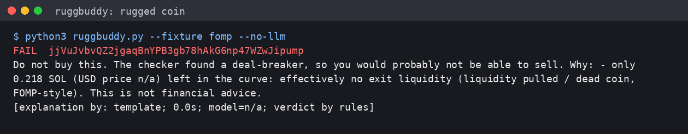

# RuggBuddy + mintcheck

**A read-only "is this Solana memecoin a trap?" checker, plus a small local AI that explains the result in plain English to a non-technical friend.**
No wallet connection. No private keys. No signing. No funds. Standard library only for the checker.



## Why this exists
Token scanners usually give a score without a reason, and a coin whose liquidity was pulled can still score "clean". The motivating case: a pump.fun coin whose trading moved to an off-curve pool, which was then withdrawn while the on-chain bonding curve sat untouched and the quoted market cap still looked healthy. `mintcheck` cross-checks the chain itself instead of trusting one score. `RuggBuddy` then says it in a sentence a friend can act on.

## How it works
1. **`mintcheck.py` (rules, no AI).** Reads public data and returns a verdict of `PASS`, `WARN` or `FAIL`, with each reason:
   - mint and freeze authority still set; risky Token-2022 extensions (permanent delegate, transfer hook, transfer fee, ...)
   - pump.fun bonding-curve state, derived on-chain (curve PDA), including how much SOL is really left to exit into
   - trading venues: only pump.fun / PumpSwap pools are verifiable from the curve; any other venue => `WARN`, or `FAIL` when an un-graduated pump.fun coin trades elsewhere (the pulled-liquidity pattern) or with `--strict-venues`
   - quoted market cap vs the on-chain curve market cap (trading off the curve is the pulled-liquidity pattern)
   - top-10 holder concentration (over 50% fails, over 30% warns) and RugCheck danger-level flags
   - fail-closed: anything unreadable => `FAIL`
2. **`ruggbuddy.py` (open-weight AI, never in charge).** A local `Qwen/Qwen2.5-0.5B-Instruct` model (494M parameters, Apache-2.0, CPU only) writes 2-3 plain sentences from the verified facts. The verdict opening ("Do not buy this." / "Be careful." / "No red flags were found...") is **prefilled from the rules**, so the model can only continue a sentence that agrees with the verdict.
3. **A guard** rejects model text that says "safe" on a non-PASS, predicts prices, uses hype words, or invents numbers or claims not in the facts. On rejection a plain template is shown instead.

Why local and open: questions never leave your machine, no API cost, and the model is swappable (`RUGGBUDDY_MODEL=<hf id>`).

## Quick start
```bash
python3 mintcheck.py <MINT>                      # rules only, stdlib; exit code 2 on FAIL
python3 serve.py                                  # tiny local UI on http://127.0.0.1:8787 (localhost only)

pip install -r requirements.txt                   # only for the AI explainer
python3 ruggbuddy.py <MINT>                       # live check + local-model explanation
python3 ruggbuddy.py --fixture fomp --no-llm      # fully offline demo, no model needed
python3 -m unittest discover -s tests -v          # 19 offline tests, no network
```
`pass` ≠ "buy". Heuristics only. Not financial advice.

## What we measured (honest numbers)
- Without the forced opening, the 0.5B model told us **"Buy this token"** on a `FAIL` verdict. That is why the verdict stays in plain code.
- On 8 fact sets (`eval_llm.py`, output in [`docs/EVAL_OUTPUT.txt`](docs/EVAL_OUTPUT.txt)) the model's text passed the guard on **3 of 8**; the other 5 fell back to the template. Even some accepted sentences were loosely reasoned. Conclusion: use the model for readable prose and trust the printed rule verdict and facts. A larger local model or a fine-tune is the next step.
- Live runs on real mints are logged in [`docs/TEST_RESULTS.txt`](docs/TEST_RESULTS.txt) (rugged pump coin => FAIL, USDC => PASS, BONK/JUP => WARN). Fixtures named `SYNTH*` are synthetic fact sets used only to exercise the explainer offline; `fomp`, `bonk` and `usdc` were recorded from real runs on 2026-10-02.
- 1-minute demo: [`docs/demo.mp4`](docs/demo.mp4), rendered from the real outputs in [`docs/DEMO_OUTPUT.txt`](docs/DEMO_OUTPUT.txt).

## Limits
Free public APIs rate-limit (HTTP 429, retried with `Retry-After`). Brand-new coins not yet indexed will `FAIL` by design. The Meteora-venue rule is covered by an offline unit test with mocked data, not by a live demo. The guard checks the verdict, banned claims and numbers, not every nuance of wording.

## Safety
See [`SECURITY.md`](SECURITY.md). This tool never asks for a wallet, seed phrase or key; only public read endpoints are called.

## Built with AI assistance
Written with an AI coding agent and reviewed by a human; all test results above come from commands that were actually run.

## License
MIT, see [`LICENSE`](LICENSE).
